# MeshCore Desktop

A desktop chat app for a MeshCore node running companion firmware, over Bluetooth LE and newly added USB node support

> **v1.1.** All features have been tested on Linux ( Fedora build ) and work. Windows builds are tested by KA1CM and working as of the current build

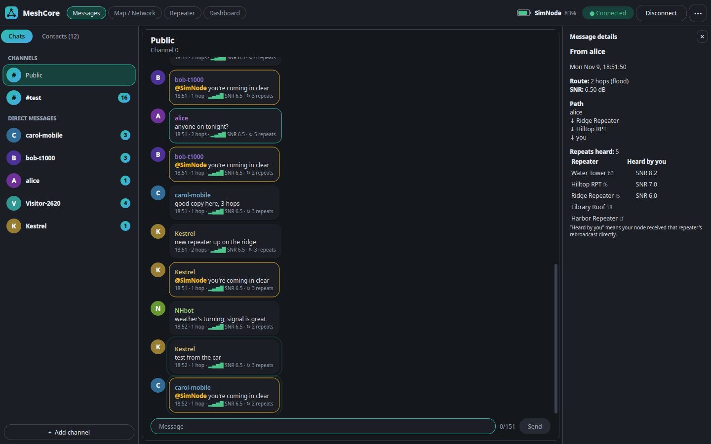

| Panels side by side | Map with node details |
|---|---|
| 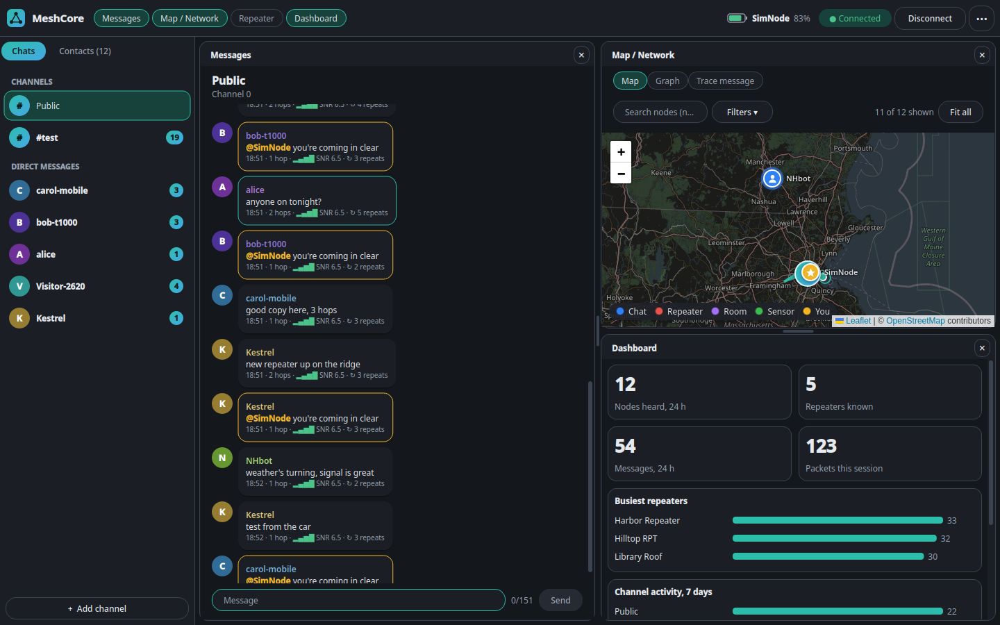 | 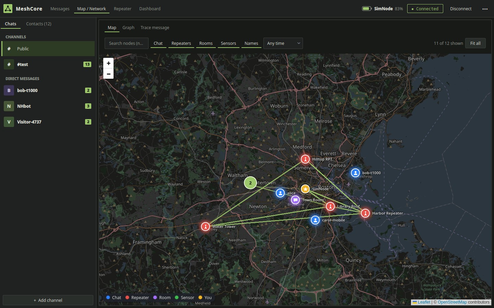 |
| **Trace a message's path** | **Relay graph** |
| 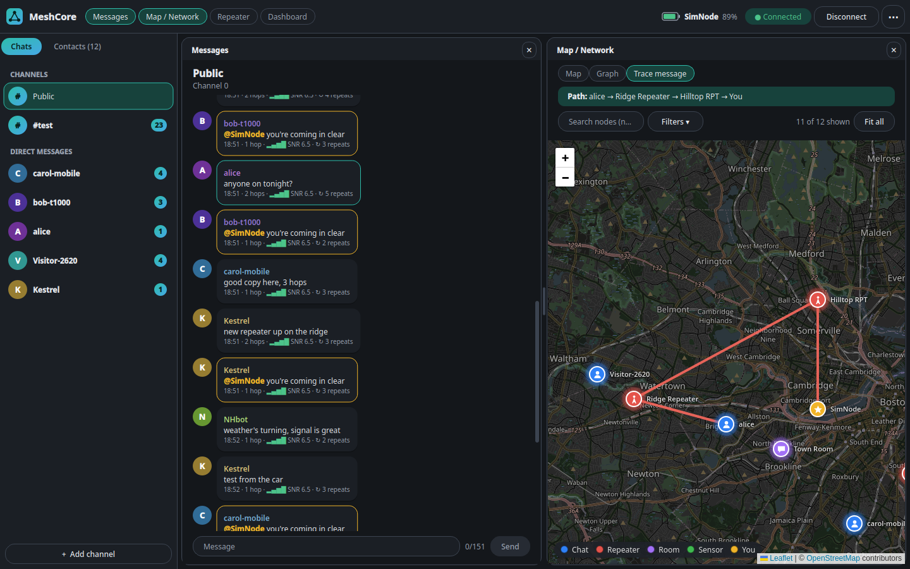 | 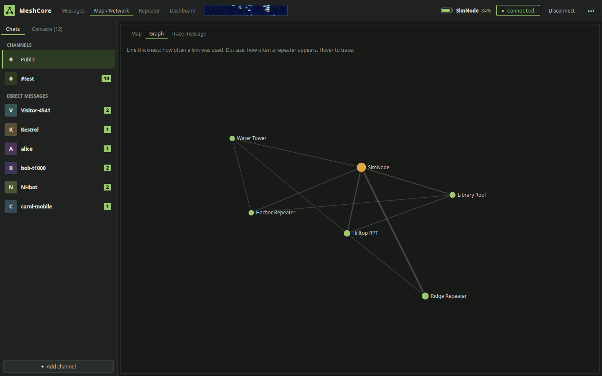 |
| **Repeater management** | **Live repeater stats** |
| 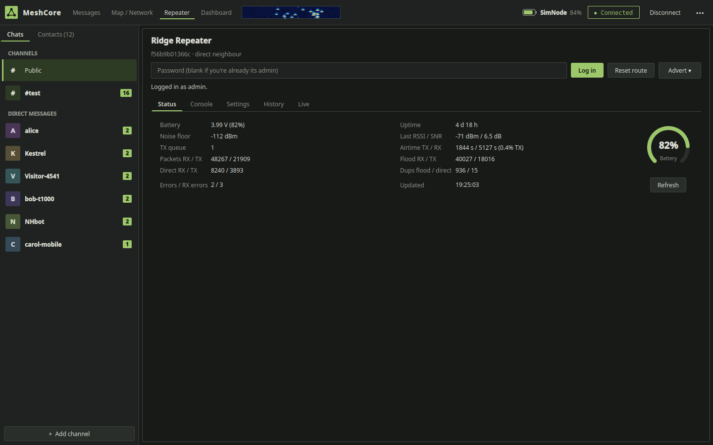 | 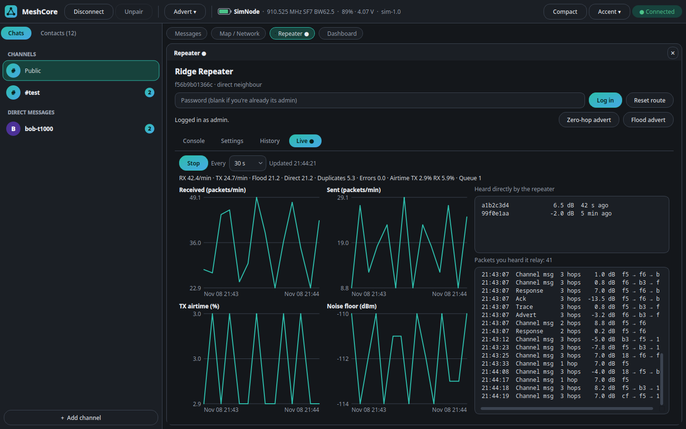 |

- Channels and direct messages, with unread counts and desktop notifications for DMs and @mentions
- Replies (`@[Name]`, double-click or Ctrl+R a message), mentions highlighted
- Repeats: how many relayed copies your node heard of each message (yours too), which
  repeaters relayed it, which you heard directly and at what SNR, and the path it took
- Delivery status on DMs (✓✓ delivered with round-trip time, ✗ no ack, right-click → send again)
- In a DM, the header shows the route to the contact. Click their name for its menu, or press **Flood** to forget the stored path so the next message floods the mesh and their reply sets a fresh one. Tick **Always flood messages** in their menu to flood every message to them
- Contacts: type and last heard, click one for its hops and route; reset route; message from the list
- Add `#hashtag` or private channels, remove channels
- Flood scopes (regions): give a channel its own scope (right-click it in Chats) and set the node's default scope (⋯ → Default flood scope), so messages stay inside an area whose repeaters allow that region
- Map with type icons, clustering, live packet paths, and full details on hover or click
- Messages, map, repeater and dashboard as tiled panels: open several at once, close each individually, and drag a title onto another panel to swap them
- Live traffic: every packet your connected node receives, as it arrives, on the Dashboard
- Packet waterfall in the toolbar, like an SDR's: each packet heard lands by its SNR and scrolls down; double-click it for a big window with minutes of history
- Dashboard with nodes heard, busiest repeaters and channel activity
- Map / Network tab: switch between the map, where each packet your node hears draws its path, and a graph of who relays through whom
- Trace message: with the map open, double-click a received message to draw the path it took in red
- Repeater battery and noise history, kept each time you refresh a repeater
- Light and dark themes that follow your system, with a choice of accent colours
- Alerts when a new repeater or contact is heard for the first time, and a list of nodes found while the app was closed
- Fits small laptop screens: tiled panels resize and reflow instead of scrolling sideways, plus a compact mode (⋯ menu or Ctrl+M)
- Sends zero-hop or flood adverts; sets the node's clock from the PC if it's behind
- Messages saved per node (~/.local/share/meshcore-desktop on Linux, %LOCALAPPDATA%\MeshCore Desktop on
  Windows, or a `data` folder beside the packaged app); reconnects when the link drops
- Node setup: a newly flashed node is spotted on connect and a wizard sets its name, region preset, position (click it on a map), channels and Bluetooth PIN
- Connects over Bluetooth LE or USB serial; plugged-in nodes show up in the connect list by themselves
- Runs on Linux (BlueZ) and Windows 10 1809+ (WinRT); Bluetooth pairing asks for the node's PIN in the app on both

## Node setup

Connect a newly flashed node and the app notices it still has its factory name (the first 8 hex digits of its key) and
offers to set it up. You can also run the setup any time from **⋯ → Set up node…**.

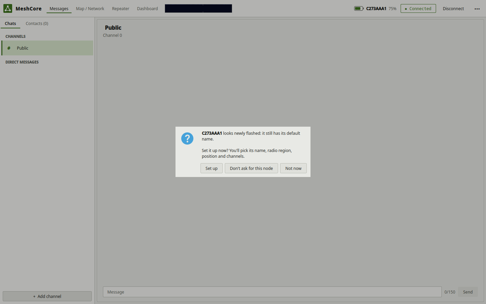

| **Radio: pick your region** | **Position: click the map** |
|---|---|
| 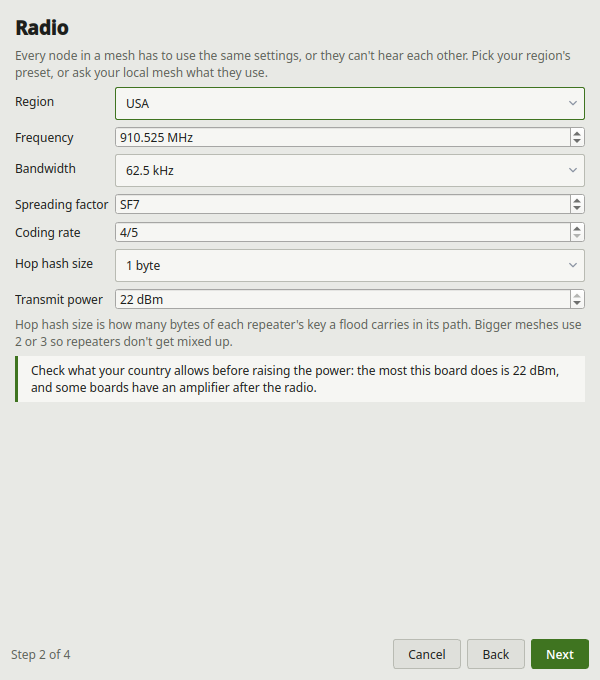 | 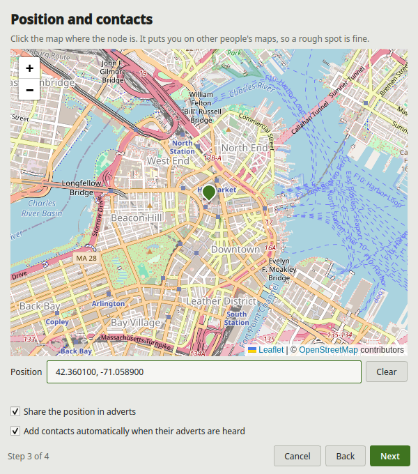 |
| **Review before anything is sent** | **Each step ticked off** |
| 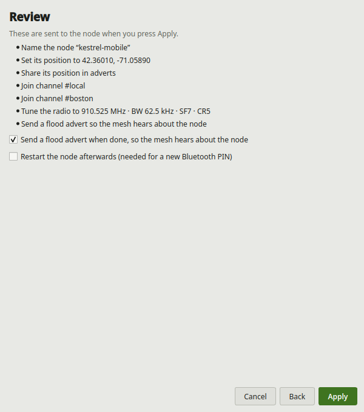 | 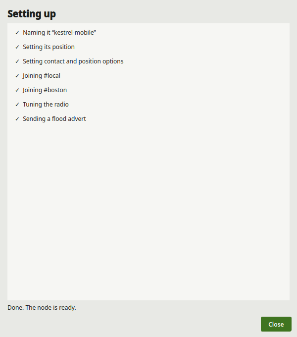 |

- **Name**: what others see in adverts and channel messages
- **Radio**: the community's regional presets (USA, Canada, EU/UK, Australia, New Zealand and more) fill in frequency,
  bandwidth, spreading factor, coding rate and hop hash size; or set them by hand. Transmit power up to the board's limit
- **Position**: click the map where the node is and drag the pin to adjust, or type coordinates; choose whether
  adverts share it. Also whether contacts are added automatically
- **Channels and Bluetooth**: join `#hashtag` channels, set the node's flood scope (region), and keep the default PIN or set a fixed one
- **Review**: only what you changed is sent. Then a flood advert so the mesh hears about the node, and a restart if
  the PIN changed

Try it without a radio with `--sim-fresh`, a simulated node that has just been flashed.

## Live traffic

The Dashboard's **Live packets** feed shows every packet your connected node's radio receives, the moment it arrives: the
time, packet type, hop count, SNR and the path it took. It includes traffic that isn't addressed to you, such as adverts,
acks and other people's messages, so you can see how busy the mesh is around your node. The list and the Dashboard's packet
count cover the current session.

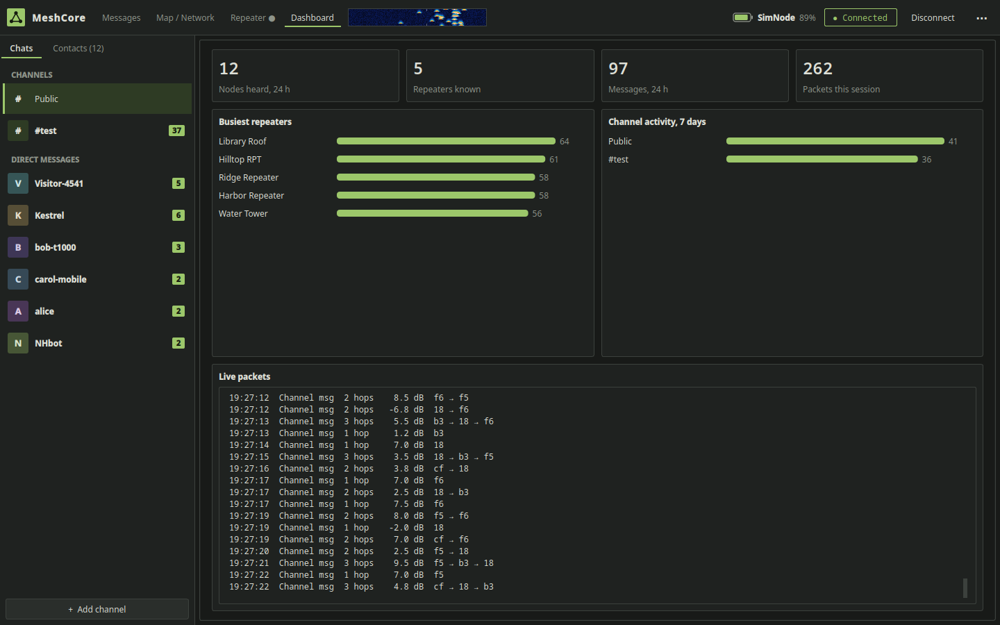

## Packet waterfall

The strip in the toolbar, right after the view chips, is a waterfall of the packets your node hears, drawn like an SDR's.
Across is SNR, from −20 dB on the left to +15 dB on the right; down is time, newest at the top. Each packet leaves a
hot spot (blue → cyan → yellow → red as it gets stronger) that scrolls away, so a quiet mesh stays dark and a busy
one lights up. Hover it for the last minute's packet count and SNR, click it for the Dashboard.

Double-click it for the **Packet waterfall** window: the same picture, bigger, with SNR and time axes and about four
minutes on screen. It opens already filled in from the last 15 minutes, and hovering a spot shows that packet's time,
type, SNR, RSSI, hops and path. It's a separate window, so it can stay open beside the app.

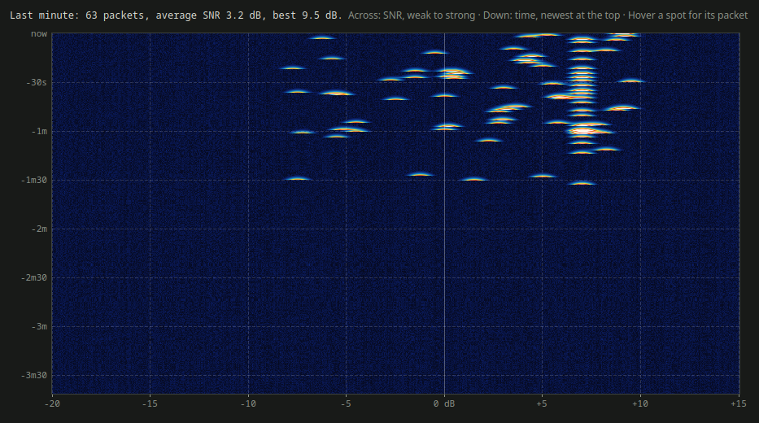

## Install

You need a node running MeshCore **companion** firmware, and either Bluetooth LE on the computer (with the
Bluetooth companion firmware) or a USB cable (with the USB companion firmware). To try the app without a radio,
use `--sim` below.

### Download a release

If there's a build on the [Releases page](https://github.com/Manthany2000/meshcore-desktop/releases), download it,
unpack it, and run `meshcore-desktop` (Linux) or `meshcore-desktop.exe` (Windows). Nothing else needs installing.

### Install script for Linux

You need Python 3.12 or newer, Git and BlueZ. This sets everything up for your user, without root, and adds the app
to your menu:

```
curl -fsSL https://raw.githubusercontent.com/Manthany2000/meshcore-desktop/main/install.sh | bash
```

It downloads to `~/meshcore-desktop`. If you already have a copy, run `./install.sh` from inside it.

### Run from source on Linux

You need the same three things.

```
git clone https://github.com/Manthany2000/meshcore-desktop.git
cd meshcore-desktop
python3 -m venv .venv
.venv/bin/pip install -r requirements.txt
./meshcore-desktop --sim      # try it with a simulated node
```

On Debian or Ubuntu, you may first need `sudo apt install git python3-venv libxcb-cursor0`.

### Run from source on Windows

You need Windows 10 1809 or newer, Python 3.12 or newer, and Git.

```
git clone https://github.com/Manthany2000/meshcore-desktop.git
cd meshcore-desktop
py -m venv .venv
.venv\Scripts\pip install -r requirements.txt
.venv\Scripts\python -m meshcore_desktop --sim
```

## Usage

```
./meshcore-desktop            # pick a node from the scan
./meshcore-desktop --sim      # a simulated node, no radio needed
./meshcore-desktop --sim-fresh   # a simulated, newly flashed node, to try node setup
./meshcore-desktop --address AA:BB:CC:DD:EE:FF
./meshcore-desktop --port /dev/ttyACM0     # a node on USB (COM3 and so on on Windows)
.venv/bin/python -m pytest tests
```

On Windows, use `.venv\Scripts\python -m meshcore_desktop` in place of `./meshcore-desktop`.

The node takes one BLE client at a time, so disconnect the phone app or anything else using it first.
The first Bluetooth connection pairs: the app asks for the PIN shown on the node's screen.

## USB nodes

Plug the node in and open **Connect**: USB serial ports are listed as `USB: <board> (<port>)` next to the Bluetooth
scan results, and the list updates as boards are plugged in or out. Pick one and connect; there's no PIN or pairing.
If the cable comes out, the app reconnects when it's plugged back in.

The node needs the **USB** companion firmware (`companion_radio_usb`, "Companion USB" on the MeshCore web flasher).
A Bluetooth companion build doesn't talk to the app over its USB port. Everything else works the same over USB:
messages, repeats, map, waterfall and repeater management.

On Linux your user needs to be in the `dialout` group to open serial ports (`sudo usermod -aG dialout $USER`, then
log out and back in); the app says so if it's missing. On Windows, boards with a CP210x or CH340 chip may need the
chip maker's driver.

Repeat counts and paths come from the node's raw packet log (push 0x88), so messages that
were queued on the node while nothing was connected have neither.

## Repeater management

In Contacts, right-click a repeater and choose **Manage repeater** to open the Repeater tab. Log in with its admin
password to read its stats and run CLI commands; the guest password gets stats only. Once you're on its admin list, a
blank password logs you back in. Zero-hop and Flood advert buttons make the repeater announce itself. The Settings page edits name, repeating, TX power, flood and advert limits (including max hops for unscoped floods), location and owner info: read the current values, change them, and Apply. The Regions page shows the repeater's region tree, home region and default scope; add or remove regions, allow or deny floods for each, set the home region and default scope, and Save so they last past a restart. The Live page polls a repeater you're admin on for packet rates, airtime, noise and neighbours, and lists the packets your node heard it relay; a repeater can't stream its full traffic over the mesh. Passwords are never saved or logged. Commands that could cut you off from a remote
repeater, such as `reboot` or `password`, ask first. In the simulator the passwords are `admin` and `guest`, and
Library Roof never answers.

## Portable builds

Self-contained folders with Python, Qt and everything else inside; nothing to install.

```
packaging/build-linux.sh      # -> dist/meshcore-desktop-linux-x86_64.tar.gz (built in an Ubuntu 22.04 container
                              #    with podman or docker; runs on glibc 2.35+ distros)
powershell -ExecutionPolicy Bypass -File packaging\build-windows.ps1
                              # on Windows -> dist\MeshCore-Desktop-windows-x64.zip
packaging/build-windows-wine.sh   # the same zip, built from Linux with Windows Python under Wine
```

`.github/workflows/build.yml` builds both on a `v*` tag or by hand from the Actions tab.

Make a folder named `data` next to the program and messages and settings are kept in it
instead of your profile, so the whole folder can move between machines. The Windows zip ships with one.
On Windows, notifications show briefly from a tray icon that goes away again (Qt can only show toasts
that way). `packaging/make_icon.py` redraws the app icon.

## Publishing

`./publish "what changed"` runs the tests, commits and pushes. `./publish --release v0.2 "what changed"` also has
GitHub build the Linux and Windows downloads and post them under Releases.

## Licence

MIT, see `LICENSE`. The bundled Leaflet map library is BSD-2-Clause and Leaflet.markercluster is MIT, see `LEAFLET-LICENSE.txt` and `MARKERCLUSTER-LICENSE.txt` in `meshcore_desktop/web/`.
