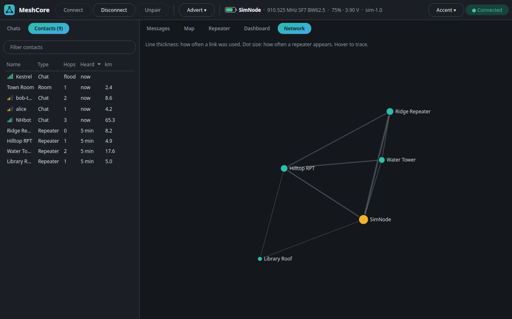

# MeshCore Desktop

A desktop chat app for a MeshCore node running companion firmware, over Bluetooth LE.
Built with PySide6 and bleak; protocol and repeat matching ported from the CYD MeshCore app.

> **Early version.** Most features, including repeater management, have only been tested against the built-in
> simulator so far (`--sim`), not on real radios. Windows builds are untested on real Windows.


| Map with node details | Repeater management |
|---|---|
|  |  |
| **Dashboard** | **Network graph** |
|  |  |

- Channels and direct messages, with unread counts and desktop notifications for DMs and @mentions
- Replies (`@[Name]`, double-click or Ctrl+R a message), mentions highlighted
- Repeats: how many relayed copies your node heard of each message (yours too), which
  repeaters relayed it, which you heard directly and at what SNR, and the path it took
- Delivery status on DMs (✓✓ delivered with round-trip time, ✗ no ack, right-click → send again)
- Contacts: type, hops, last heard, distance; reset route; message from the list
- Add `#hashtag` or private channels, remove channels
- Map with type icons, clustering, live packet paths, and full details on hover or click
- Dashboard with activity and a live packet feed, plus a graph of who relays through whom
- Repeater battery and noise history, kept each time you refresh a repeater
- Light and dark themes that follow your system, with a choice of accent colours
- Sends zero-hop or flood adverts; sets the node's clock from the PC if it's behind
- Messages saved per node (~/.local/share/meshcore-desktop on Linux, %LOCALAPPDATA%\MeshCore Desktop on
  Windows, or a `data` folder beside the packaged app); reconnects when the link drops
- Runs on Linux (BlueZ) and Windows 10 1809+ (WinRT); pairing asks for the node's PIN in the app on both

## Install

You need a computer with Bluetooth LE and a node running MeshCore **companion** firmware with Bluetooth enabled.
To try the app without a radio, use `--sim` below.

### Download a release

If there's a build on the [Releases page](https://github.com/Manthany2000/meshcore-desktop/releases), download it,
unpack it, and run `meshcore-desktop` (Linux) or `meshcore-desktop.exe` (Windows). Nothing else needs installing.

### Install script for Linux

You need Python 3.12 or newer, Git and BlueZ. This sets everything up for your user, without root, and adds the app
to your menu:

```
curl -fsSL https://raw.githubusercontent.com/Manthany2000/meshcore-desktop/main/install.sh | bash
```

It downloads to `~/meshcore-desktop`. If you already have a copy, run `./install.sh` from inside it.

### Run from source on Linux

You need the same three things.

```
git clone https://github.com/Manthany2000/meshcore-desktop.git
cd meshcore-desktop
python3 -m venv .venv
.venv/bin/pip install -r requirements.txt
./meshcore-desktop --sim      # try it with a simulated node
```

On Debian or Ubuntu, you may first need `sudo apt install git python3-venv libxcb-cursor0`.

### Run from source on Windows

You need Windows 10 1809 or newer, Python 3.12 or newer, and Git.

```
git clone https://github.com/Manthany2000/meshcore-desktop.git
cd meshcore-desktop
py -m venv .venv
.venv\Scripts\pip install -r requirements.txt
.venv\Scripts\python -m meshcore_desktop --sim
```

## Usage

```
./meshcore-desktop            # pick a node from the scan
./meshcore-desktop --sim      # a simulated node, no radio needed
./meshcore-desktop --address AA:BB:CC:DD:EE:FF
.venv/bin/python -m pytest tests
```

On Windows, use `.venv\Scripts\python -m meshcore_desktop` in place of `./meshcore-desktop`.

The node takes one BLE client at a time, so disconnect the phone app or anything else using it first.
The first connection pairs: the app asks for the PIN shown on the node's screen.

Repeat counts and paths come from the node's raw packet log (push 0x88), so messages that
were queued on the node while nothing was connected have neither.

## Repeater management

In Contacts, right-click a repeater and choose **Manage repeater** to open the Repeater tab. Log in with its admin
password to read its stats and run CLI commands; the guest password gets stats only. Once you're on its admin list, a
blank password logs you back in. Zero-hop and Flood advert buttons make the repeater announce itself. The Settings page edits name, repeating, TX power, flood and advert limits, location and owner info: read the current values, change them, and Apply. Passwords are never saved or logged. Commands that could cut you off from a remote
repeater, such as `reboot` or `password`, ask first. In the simulator the passwords are `admin` and `guest`, and
Library Roof never answers.

## Portable builds

Self-contained folders with Python, Qt and everything else inside; nothing to install.

```
packaging/build-linux.sh      # -> dist/meshcore-desktop-linux-x86_64.tar.gz (built in an Ubuntu 22.04 container
                              #    with podman or docker; runs on glibc 2.35+ distros)
powershell -ExecutionPolicy Bypass -File packaging\build-windows.ps1
                              # on Windows -> dist\MeshCore-Desktop-windows-x64.zip
packaging/build-windows-wine.sh   # the same zip, built from Linux with Windows Python under Wine
```

`.github/workflows/build.yml` builds both on a `v*` tag or by hand from the Actions tab.

Make a folder named `data` next to the program and messages and settings are kept in it
instead of your profile, so the whole folder can move between machines. The Windows zip ships with one.
On Windows, notifications show briefly from a tray icon that goes away again (Qt can only show toasts
that way). `packaging/make_icon.py` redraws the app icon.

## Publishing

`./publish "what changed"` runs the tests, commits and pushes. `./publish --release v0.2 "what changed"` also has
GitHub build the Linux and Windows downloads and post them under Releases.

## Licence

MIT, see `LICENSE`. The bundled Leaflet map library is BSD-2-Clause and Leaflet.markercluster is MIT, see `LEAFLET-LICENSE.txt` and `MARKERCLUSTER-LICENSE.txt` in `meshcore_desktop/web/`.
